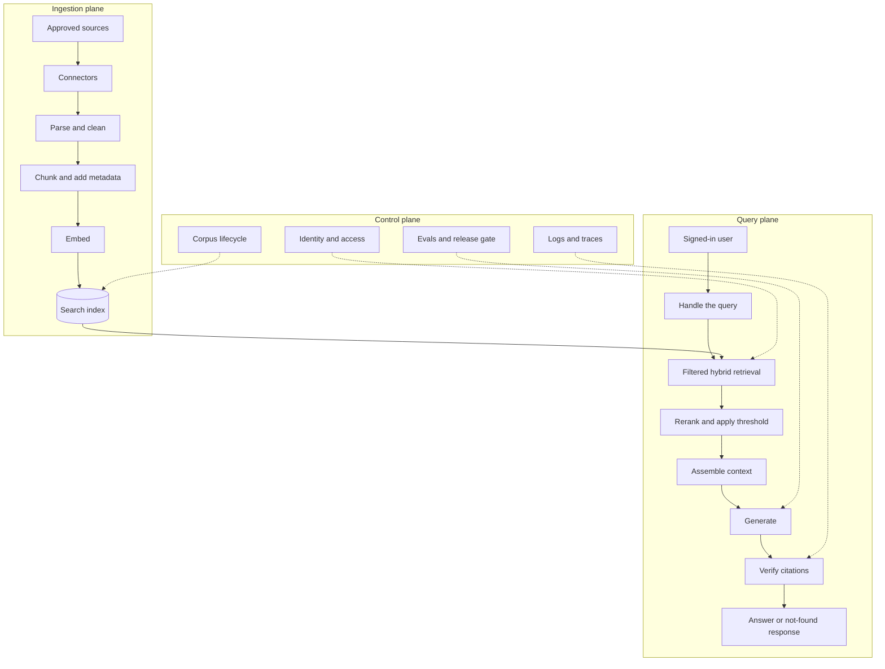

# Objective

Provide a vendor-neutral reference design for retrieval-augmented generation (RAG) that answers from approved sources, respects each reader's permissions, and can be tested, audited, and corrected.

This note describes the whole system:
- For build steps, see [[02-Practical-Implementation/RAG-Implementation]].
- For evidence rules, see [[02-Practical-Implementation/Research-RAG-and-Evidence]].
- For a Microsoft design, see [[M365 RAG Architecture]].
- For the layers around RAG in a production assistant, see [[Production-AI-Assistant-Stack]].

The component split, stages, and review questions below are recommended practice, not an external standard.

---

# When to Use This Pattern

| Need | Use |
|---|---|
| Answers from documents that change, with citations | RAG |
| A figure or record from a database | A governed query tool |
| A small, stable set of instructions | Prompt context |
| A transaction, such as a booking or refund | An API with its own limits |
| A list of matching documents | Search without generation |

When this pattern underperforms, check the corpus and permissions before you tune the model.

---

# Reference Design

The design has three planes. Ingestion prepares content ahead of any question. The query plane answers one question. The control plane keeps both trustworthy.

---

# Core Components

| Component | Responsible For | Key Decision | Failure If Weak |
|---|---|---|---|
| Connectors | Pull content and its permissions from each source | Which source is authoritative | Stale or unofficial copies get indexed |
| Parser | Turn files into clean text, keeping tables and headings | Which formats need OCR or layout parsing | Tables and scans become noise |
| Chunker | Split content at meaningful boundaries | Size and boundaries by document type | The exception lands in a chunk that isn't retrieved |
| Metadata | Attach source, version, owner, and access fields | Which fields are mandatory | No filtering, citation, or audit |
| Embedder | Turn chunks into vectors | Model and version, plus a plan to re-embed | A model change leaves mixed vectors in one index |
| Search index | Store chunks, vectors, and filter fields | Which deployment pattern to use | Filters or scale don't meet the need |
| Query handler | Rewrite follow-ups and route the question | When to rewrite, route, or decline | Vague follow-ups retrieve the wrong content |
| Retriever | Combine keyword and vector search under an access filter | Filter inside the search call | Exact terms are missed, or restricted content is ranked |
| Reranker | Reorder candidates by relevance | Candidate count and threshold | Weak matches reach the model |
| Context builder | Choose what the model sees within a token budget | Order, duplicates, and budget | The best evidence is crowded out |
| Generator | Answer from context, with citations | Model and evidence prompt | The model fills gaps from general knowledge |
| Citation checker | Confirm each citation exists and supports its claim | Block or flag a failure | Citations look right but prove nothing |
| Response cache (optional) | Reuse answers to save cost and time | Key by access group and corpus version | Answers cross permission lines or outlive a policy |

---

# Ingestion Flow

1. Register the source with an owner, sensitivity level, and refresh rule.
2. Pull the content and its access rules together.
3. Reject drafts, duplicates, and content with no owner.
4. Parse the content, and check the output on a sample of each format.
5. Audit for hidden instructions and poisoned content. Ingest only from vetted, authenticated sources.
6. Chunk the content and attach the metadata contract.
7. Embed the chunks and write them to the index with a corpus version.
8. Run a known-answer test to confirm the new content can be retrieved.

When a source changes, apply the Retrieval Corpus Lifecycle rule in [[03-Enterprise-Concerns/PromptOps-Governance]]. Remove or supersede the old chunks, invalidate cached answers, and confirm the old content can no longer reach an answer.

---

# Query Flow

1. **Authenticate:** Identify the user and resolve their groups at query time.
2. **Handle the query:** Turn follow-ups into standalone questions, and route anything out of scope.
3. **Retrieve:** Run keyword and vector search together, with the access filter inside the search call.
4. **Rerank:** Reorder candidates and drop those below the relevance threshold.
5. **Decide:** If nothing clears the threshold, return the not-found response without generating an answer.
6. **Assemble:** Label retrieved text as data, and fit the best evidence into the token budget.
7. **Generate:** Answer only from the context, and cite each claim.
8. **Verify:** Check that each citation exists and supports its claim.
9. **Log:** Record the user, query, chunk IDs and versions, scores, prompt and model versions, and answer.

The not-found response is part of the design:

> The provided sources do not contain enough evidence to answer this.

---

# Metadata Contract

Every chunk carries these fields. [[02-Practical-Implementation/Research-RAG-and-Evidence]] shows a full example.

| Field | Why It's Needed |
|---|---|
| `chunk_id` | Traces an answer back to its exact passage |
| `source_title` | Gives a readable citation |
| `source_type` | Separates policy from guidance and commentary |
| `owner` | Names who fixes wrong content |
| `version` | Shows which edition produced an answer |
| `approval_status` | Keeps drafts out of retrieval |
| `effective_date` | Handles policies that take effect later |
| `last_updated` | Supports freshness checks |
| `page` | Makes citations checkable |
| `section` | Makes citations checkable |
| `access_group` | Drives the access filter |
| `sensitivity` | Drives handling, logging, and routing rules |

---

# Trust Boundaries

| Boundary | Rule |
|---|---|
| Access | Filter by the user's identity inside the retrieval call. Never rely on the model to withhold what it was given. |
| Permission changes | Measure how long a permission change takes to reach the index, and treat that lag as a risk. |
| Retrieved text | Treat it as untrusted data, even from internal sources. See [[Security-and-Privacy]]. |
| Tools | RAG alone can mislead. RAG with tools can act, so set the tier with [[Prompt-Risk-Tiering]]. |
| Derived copies | Apply the source's classification, retention, and deletion rules to chunks, embeddings, and caches. |
| Tenants | Partition data strictly by tenant or user group, and test that the partition holds. |
| Cache | Key entries by access group and corpus version, or don't cache. |
| Logs | Retrieval logs can contain sensitive text. Protect them like the sources. |

OWASP lists permission-aware vector stores, strict partitioning, validated sources, and detailed retrieval logs among its mitigations for vector and embedding weaknesses.

---

# Deployment Patterns

| Pattern | Best Fit | You Run | Main Trade-off |
|---|---|---|---|
| Platform-native | Content already sits in one suite, with little need to tune | Permissions, content quality, connectors | Little control over chunking and ranking |
| Managed search with your own orchestration | Mixed sources, custom experiences, or strict evals | Ingestion, query flow, evals, limits | More to build and operate |
| Self-hosted | Residency, air gap, or sustained high volume | Everything, including inference | Highest staffing and upgrade load |

Choose the least you can run that still meets your access, citation, and evaluation needs. [[M365 RAG Architecture]] applies this to the first two patterns. [[Local-vs-Cloud-Architecture]] covers the third.

---

# Maturity Stages

Tiers come from [[Prompt-Risk-Tiering]]. A stage doesn't set the tier. The data and the decisions it affects do, and indexing outside content can raise the minimum tier.

| Stage | Scope | Controls to Add | Usual Tier |
|---|---|---|---|
| 1. Pilot | One owned corpus with one permission set | Approved sources, metadata contract, citations, not-found response, small golden set | 1 to 2 |
| 2. Departmental | Several sources with different permissions | Access filter, two-user test, hybrid retrieval, reranking, logging | 2 to 3 |
| 3. Enterprise | Sensitive content across teams | Regression evals, release gate, kill switch, incident playbook, corpus lifecycle | 3 |
| 4. Action-enabled | RAG feeds tools that change records | Hard limits in tools, human approval, separate extraction of outside content | 4 and above |

---

# Evaluation

Test each layer separately, so a failure points to its cause. [[Evaluation-and-Testing]] covers the suite and the release gate.

| Layer | Question | Test |
|---|---|---|
| Retrieval | Did the right chunks come back? | Golden questions with known source chunks |
| Access | Can a user reach content they shouldn't? | The same question from two users in different groups |
| Grounding | Does the source support each claim? | Claim-by-claim review or a scoring tool |
| Citation | Does each citation exist and support its claim? | Automated lookup plus sampling |
| Answer | Is the answer correct and useful? | Review by a subject expert |
| Not-found | Does it decline when the source isn't there? | Questions the corpus can't answer |
| Freshness | Is superseded content gone? | Known-answer test after each update |
| Injection | Does a planted instruction change behavior? | A seeded document in a test corpus |

---

# Operating Metrics

| Metric | What It Reveals |
|---|---|
| Not-found rate | Corpus gaps, or a threshold set too high |
| Answers without citations | Prompt or retrieval failures |
| Retrieval score trend | Drift after content or model changes |
| Index freshness lag | How far answers trail the sources |
| Permission sync lag | How long a removed user keeps access |
| Latency by stage | Which stage to tune first |
| Cost per answer | Whether the design still pays for itself |
| Top unanswered questions | What content to add next |

---

# Ownership

| Role | Owns |
|---|---|
| Content owner | Accuracy, approval, and retirement of each source |
| Platform team | Ingestion, index, query flow, and availability |
| Security | Access model, partitioning, and log protection |
| Prompt owner | Evidence prompt, versions, and registry entry |
| Evaluation owner | Golden set, regression suite, and release gate |

---

# Common Failure Modes

| Failure | Cause | Mitigation |
|---|---|---|
| Restricted content appears in an answer | Filter applied after retrieval, or stale permissions | Filter in the search call and measure sync lag |
| The old policy is still cited | Old chunks or cached answers remain | Apply the Retrieval Corpus Lifecycle rule |
| Part numbers and policy IDs aren't found | Vector search alone | Use hybrid retrieval |
| A confident answer has a wrong citation | No citation check | Verify each citation before responding |
| A good answer disappears after a model change | No regression suite | Run evals on every change and on a schedule |
| A planted instruction steers the answer | Retrieved text treated as instructions | Label it as data, and limit tools |
| Retrieval works in the pilot, then degrades | Corpus growth without evals | Keep the golden set current and track score trends |
| Users stop trusting it | Wrong answers with no way to report them | Add feedback and name a content owner |

---

# Design Review Questions

Use these to review a design before approval:

1. Who owns each source, and who retires it?
2. Where is the access filter applied, and has a two-user test passed?
3. How long does a permission change take to reach the index?
4. What does the system say when the sources don't contain the answer?
5. Can you trace any answer to its chunk, version, prompt, and model?
6. What happens to chunks and cached answers when a policy changes?
7. Can retrieved text trigger a tool, and what stops it?
8. Which tests must pass before a change ships?
9. How do you disable the system without a deployment?
10. Who reviews unanswered questions and wrong-answer reports?

---

# Related Notes

- [[02-Practical-Implementation/RAG-Implementation]]
- [[02-Practical-Implementation/Research-RAG-and-Evidence]]
- [[Advanced-RAG-Techniques]]
- [[M365 RAG Architecture]]
- [[Production-AI-Assistant-Stack]]
- [[Vector-Database-Comparison]]
- [[AI-Incident-Response-Playbook]]

---

# Sources

- [OWASP LLM08:2025 Vector and Embedding Weaknesses](https://genai.owasp.org/llmrisk/llm08-excessive-agency/)
